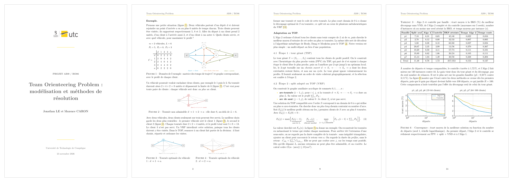

# Team Orienteering Problem - AI09 / RO06

[](docs/Rapport_TOP_AI09_RO06_LE-Jonathan_CARON-Maxence.pdf)

Code du projet « Problèmes de tournées sélectives » de l'UTC (AI09 / RO06, 2026).

**Auteurs :** Jonathan LE et Maxence CARON

| Document | Lien |
| --- | --- |
| Sujet du projet | [`docs/Sujet_TOP_AI09_RO06.pdf`](docs/Sujet_TOP_AI09_RO06.pdf) |
| Rapport | [`docs/Rapport_TOP_AI09_RO06_LE-Jonathan_CARON-Maxence.pdf`](docs/Rapport_TOP_AI09_RO06_LE-Jonathan_CARON-Maxence.pdf) |

Le dépôt contient le code, les données et les résultats du rapport :

- **PLNE** (section 2) : formulation à flux, résolue avec JuMP et HiGHS ;
- **Algo 1** (section 3) : meilleure insertion profit/temps, puis descente (VND) ;
- **Algo 2** (section 4) : tour géant, découpage par programmation dynamique, multi-départ et VND.

## Lancer le projet

**1. Installer Julia (1.13 ou plus) et Python 3**, puis ouvrir un nouveau terminal :

| Système | Commandes |
| --- | --- |
| Windows (PowerShell) | `winget install --name Julia --id 9NJNWW8PVKMN -e -s msstore`<br>`winget install Python.Python.3.12` |
| macOS | `curl -fsSL https://install.julialang.org \| sh` |
| Linux (Debian, Ubuntu) | `sudo apt install curl python3`<br>`curl -fsSL https://install.julialang.org \| sh` |

**2. Récupérer le code** (ou *Code → Download ZIP* sur GitHub) :

```sh
git clone https://github.com/jonathan-is-working/team-orienteering-problem.git
cd team-orienteering-problem
```

**3. Lancer le menu** (`python lancer.py` sous Windows) :

```sh
python3 lancer.py
```

Au premier lancement, le menu installe les dépendances Julia, ce qui prend quelques minutes. Il propose ensuite de :

1. résoudre une instance avec l'Algo 1, l'Algo 2 et/ou la PLNE, et afficher les tournées ;
2. lancer les tests ;
3. recalculer les résultats des heuristiques (environ 10 min) ;
4. recalculer les résultats de la PLNE (environ 1 h 45) ;
5. régénérer les tableaux et figures du rapport ;
6. ouvrir le rapport.

Ce petit menu en Python ne fait qu'appeler les commandes Julia du projet (`scripts/solve.jl`, `benchmark.jl`, `analyze.jl`, `test/runtests.jl`), pour éviter de les taper à la main. Les résultats du rapport sont déjà dans `results/`.

## Organisation

```text
docs/              sujet, rapport et aperçu
src/               PLNE (milp.jl), Algo 1 (insertion.jl), Algo 2 (split.jl), VND (local_search.jl), validateur (core/)
scripts/           solve.jl, benchmark.jl, analyze.jl
test/              tests
data/              387 instances de Chao, meilleures solutions connues, provenance
results/           résultats bruts, tableaux et données des figures
lancer.py          menu de lancement
```

Les instances viennent de Chao, Golden et Wasil (1996), et les meilleures solutions connues de Bouly, Dang et Moukrim (2010). Les sources sont détaillées dans [`PROVENANCE.md`](data/benchmarks/chao/PROVENANCE.md). Le code est sous licence [Apache 2.0](LICENSE).
